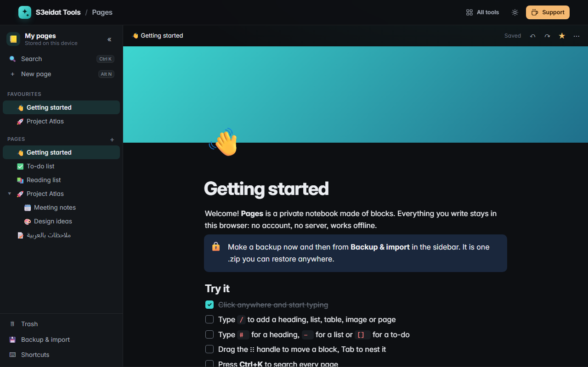

# Pages

> Notes and docs made of blocks, with a nested sidebar, search and full backup. Free, private, offline, and it runs entirely in your browser.

A free alternative to block-based note apps like Notion, for one person on one device: no account, no server, nothing uploaded.

### ▶ [Open Pages](https://s3eidat.github.io/pages/)



## Features

- **Blocks**: text, headings 1–3, bulleted / numbered / to-do lists, toggles, quotes, callouts (icon + colour), dividers, code, simple tables, images from your device, links to pages and inline page mentions
- **Type fast**: the `/` menu, Markdown shortcuts at the start of a line (`# `, `## `, `- `, `1. `, `[] `, `> `, `>> ` toggle, ```` ``` ````, `---`), and inline `**bold**`, `*italic*`, `` `code` ``, `~~strike~~`, `==highlight==` as you type
- **Inline formatting**: bold, italic, underline, strikethrough, code, highlight and links from a toolbar or the keyboard; `javascript:` and other unsafe links are refused
- **Move things**: drag the ⋮⋮ handle (mouse, pen or touch), `Tab` / `Shift+Tab` to nest, `Ctrl+Shift+↑/↓` to move, `Esc` to select blocks and copy them as Markdown
- **Organise**: pages inside pages as deep as you like, drag pages in the sidebar to reorder or nest, favourites, emoji icons, colour and gradient covers, serif / mono fonts, full width
- **Find again**: `Ctrl+K` searches titles and text of every page; it ignores Arabic diacritics and alef forms
- **Trash** with restore (sub-pages come back too), plus undo / redo for every edit
- **Arabic and RTL**: every block follows its own text direction, with a per-block override
- **Export**: a page as Markdown (zip with images), as one HTML file with images embedded, or print / save as PDF; every page as a Markdown folder zip
- **Backup**: one `.zip` (validated JSON + every image) that imports back exactly, in any browser; import Markdown files or a zip of Markdown exported from another notes app
- Autosaves to this browser (IndexedDB), works offline after the first visit, light and dark themes

## Privacy

Your pages and images are stored in this browser on this device and never leave it. There is no server, no account, no analytics.
The page ships with a strict Content-Security-Policy (`connect-src 'self'`), so the browser itself blocks any attempt to send data anywhere.
Clearing this site's data deletes your pages, so download a backup now and then.

## Run it yourself

It's plain HTML, CSS and JavaScript with no build step:

```bash
git clone https://github.com/s3eidat/pages
cd pages
python -m http.server 8000
```

Then open http://localhost:8000.

Uses [JSZip](https://github.com/Stuk/jszip) (MIT) for backup and import.

## Support

If this saved you time, **[buy me a coffee ☕](https://s3eidat.github.io/coffee/)**. It keeps every tool free.

---

Part of **[S3eidat Tools](https://s3eidat.github.io/)**: 100+ free, private tools that run in your browser. MIT licensed.
